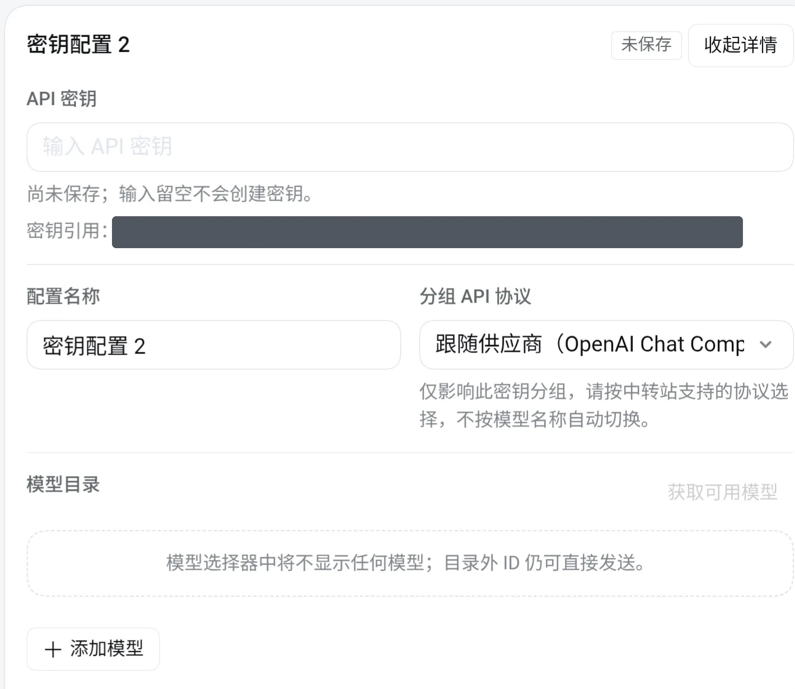
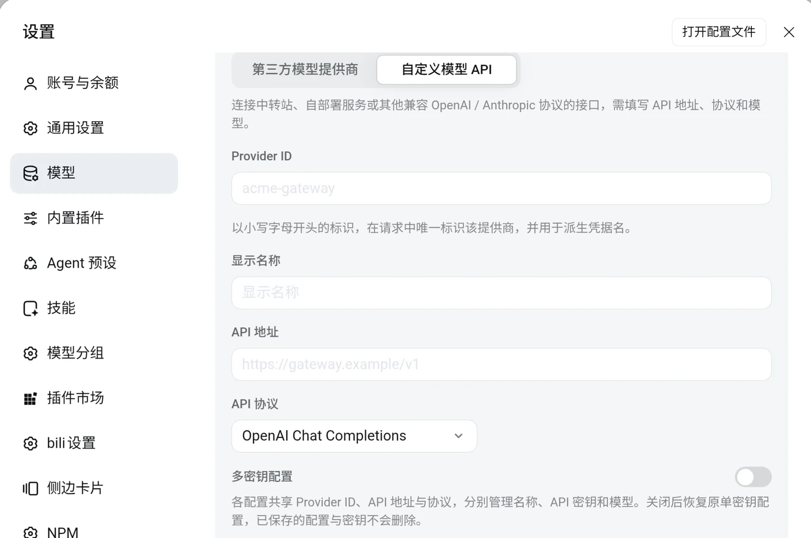
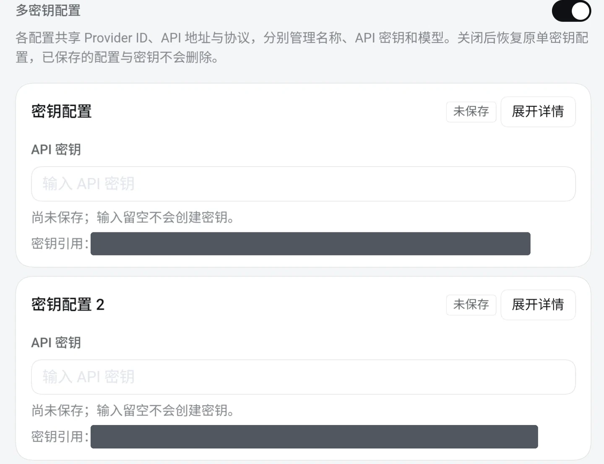
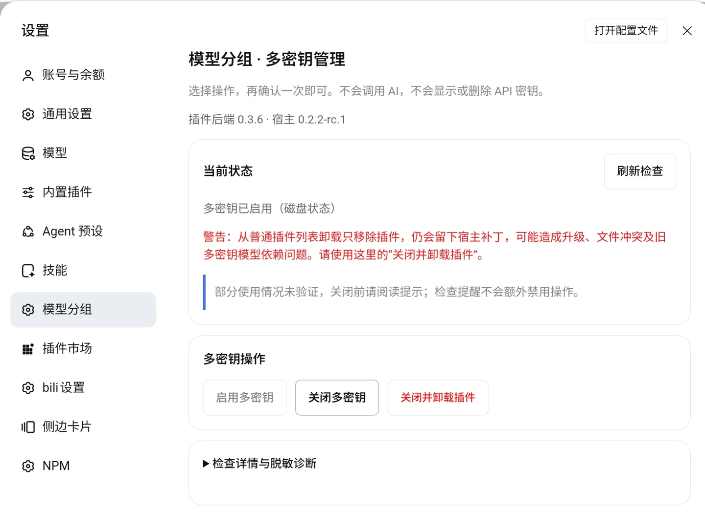

# DSH Model Groups · 模型分组

**在 DeepSeek Harness（DSH）网页端，按供应商、密钥配置和模型逐级选择。** 如果同一家供应商有多把 API 密钥，可以为每把密钥分别设置模型列表和 API 协议。即使模型名称一样，也能选中你要用的那份配置。插件不会自动换密钥或切换供应商。

支持 **DSH `0.2.2-rc.1`**、**Node.js 22 或更新版本**。本插件适用于 DSH 网页端，不替换原生 App 的模型菜单。

## 测试版 · 0.3.10-beta.2

本分支增加**密钥分组的识图与思考强度批量开关**：开则全开，关则全关，新模型沿用最近一次批量设置。模型行和详情保持原版，单独调整仍使用原来的控件。沿用原保存按钮。

本版尚未正式发布，请使用交付的固定提交测试安装命令；下面的 `@latest` 仍是正式版。安装测试版后需要更新多密钥补丁、重启同一个 DSH 引擎并刷新网页。[测试位置与验收说明](docs/capabilities-beta.md)。

## 上次正式更新 · 0.3.9

- **手机也能排序**：在设置页长按三横线手柄约 400 毫秒，即可调整密钥分组及组内模型顺序；蓝色插入线会提示落点，靠近边缘可自动滚动。
- **保存后顺序保留**：使用原表单保存按钮，退出再进入设置、打开聊天模型菜单都沿用已保存顺序。未保存的输入和展开状态会保留。
- **修复测试版排序回退**，并分别显示插件前端、后端版本，方便核对更新。

升级到本版后，需要在 **设置 → 模型分组** 更新多密钥补丁，再重启 DSH 引擎并刷新网页。

查看 [每次更新的内容](CHANGELOG.md) · [GitHub 发布记录与安装包](https://github.com/betsunninda9-lgtm/dsh-model-groups/releases)。

## 安装

在运行 DSH 的环境里执行（如果你使用的 DSH 配置不是 `web`，把命令中的 `web` 换成你的配置名）：

```bash
dsh plugin --profile web add dsh-model-groups@latest --registry=https://registry.npmjs.org/
```

如果 npm 尚未同步到你需要的版本，可以把 `dsh-model-groups@latest` 换成 [GitHub 0.3.9 正式版安装包](https://github.com/betsunninda9-lgtm/dsh-model-groups/releases/download/v0.3.9/dsh-model-groups-0.3.9.tgz) 的下载地址。安装后，**重启正在使用的 DSH 引擎，再刷新网页**。只想给现有模型分组？装好就可以用，不需要启用多密钥。

## 在对话中选模型

打开输入框旁的模型菜单，展开供应商，选择模型。启用了多密钥的供应商会多一级 **密钥配置**。你可以搜索模型或配置名称、展开或收起全部分组，也可以在菜单底部切换 **侧边面板** 或 **原地折叠**。清空搜索后会恢复原来的展开状态。

开启多密钥前就已选中普通模型的会话会保留原选择，菜单中标为 **原单密钥（兼容旧会话）**。

## 为同一家供应商添加多把密钥

### 启用多密钥

1. 在网页打开 **设置 → 模型分组**，点击 **启用多密钥 → 确认执行**。
2. 等页面提示已更新 DSH 文件后，**重启 DSH 引擎，再刷新网页**。只刷新网页不够。

这一步会检查并备份 DSH 程序文件，再安装补丁。安装目录必须可写；如果文件版本无法识别，插件会停止，不会强行覆盖。

### 添加密钥配置

1. 打开 **设置 → 模型**，新增或编辑一个支持多密钥的供应商。在 **公共设置** 中填写共享的 API 地址和默认协议。
2. 打开 **多密钥配置**，为第一项填写配置名称、API 密钥和模型列表；有更多密钥就点击 **添加密钥配置**。
3. 如果某把密钥需要不同的 API 协议，在 **分组 API 协议** 中选择；不确定时保留 **跟随供应商**，并以供应商说明为准。可选协议包括 OpenAI Chat Completions、OpenAI Responses 和 Anthropic Messages。API 地址写中转站给你的那个（结尾带不带 `/v1` 都可以）：Anthropic 这一项会自动去掉结尾的 `/v1`，避免同一段路径出现两次。
4. 点击 **应用**（新建时点击 **创建提供商**）。已保存的配置默认收起；要修改模型列表，点击 **展开详情**。编辑时将已保存的密钥输入框留空，原密钥会保留。



*展开一项密钥配置后，可以设置该项的 API 协议和模型列表。截图中的内部密钥引用已遮盖。*

<details>
<summary>查看开关位置、折叠效果和添加按钮</summary>

**找到开关**：新建供应商时，选择 **自定义模型 API**，在 **API 协议** 下方打开 **多密钥配置**。



**查看多份配置**：点击 **展开详情** 编辑对应配置，不必逐个展开其他配置。



**继续添加**：在配置列表下方点击 **添加密钥配置**。每份密钥配置至少需要一个模型。


</details>

如果只想让某个供应商恢复使用单密钥，先保存或清空尚未保存的密钥输入，再关掉该供应商的 **多密钥配置** 并点击 **应用**。已保存的多密钥配置不会被删除。

## 更新

1. 在原 DSH 配置中用目标正式版本重新执行安装命令，**不需要先卸载**。重启 DSH 引擎并刷新网页。
2. 打开 **设置 → 模型分组**。如果出现 **更新多密钥补丁**，点击并确认；更新完成后，再重启引擎并刷新网页。没有更新提示就不用重复操作。

已识别且受支持的旧补丁可以直接更新，不用逐版安装。若提示文件冲突或不支持更新，请先复制诊断反馈；不要先卸载、还原补丁或删除配置。升级 **DSH 本身**前，请先确认目标 DSH 版本是否受插件支持。

## 关闭或卸载

**如果已启用多密钥，不要直接从插件列表或命令行卸载。** 那样只会移除插件，不会还原 DSH 文件。

1. 保存设置草稿、停止运行中的任务，并把仍使用多密钥模型的会话、默认模型及子代理切回普通模型。建议先在各供应商设置里关闭 **多密钥配置** 并应用。
2. 打开 **设置 → 模型分组**，选择 **关闭多密钥**（保留模型分组插件），或 **关闭并卸载插件**（先还原 DSH 文件，再卸载），然后确认。
3. 页面提示需要重启时，**重启 DSH 引擎并刷新网页**。



*「设置 → 模型分组」在多密钥已启用时的界面（0.3.6）。按钮会随当前状态变化。*

关闭或卸载不会删除 API 密钥、供应商配置、聊天历史或备份，也不会替你切换模型。还原后，旧会话里的多密钥模型可能无法继续使用；原版 DSH 也可能无法读取残留的多密钥设置。遇到这种情况请先反馈诊断，不要直接删除密钥或整个配置。

## 遇到问题

- **找不到多密钥开关**：先确认已在 **设置 → 模型分组** 启用，并已重启引擎、刷新网页。只有支持多密钥的供应商编辑页会显示此开关，只能填写凭据的简化页面不会显示。
- **不确定是否已经生效**：设置页的 **刷新检查** 只检查文件，不会修改文件或重启引擎。若刚启用、更新或关闭多密钥，请重启引擎再刷新网页。
- **无法启用、更新或卸载**：打开 **设置 → 模型分组 → 检查详情与脱敏诊断**，点击 **复制脱敏诊断**，附在 [GitHub Issue](https://github.com/betsunninda9-lgtm/dsh-model-groups/issues) 中。该诊断不包含 API 密钥、文件路径、配置正文或聊天记录。

开发、测试和命令行恢复说明见 [维护指南](docs/maintenance.md)。项目基于 [MIT 许可证](LICENSE) 开源。部分模型选择器代码改编自 DeepSeek Harness，保留原始版权声明。
