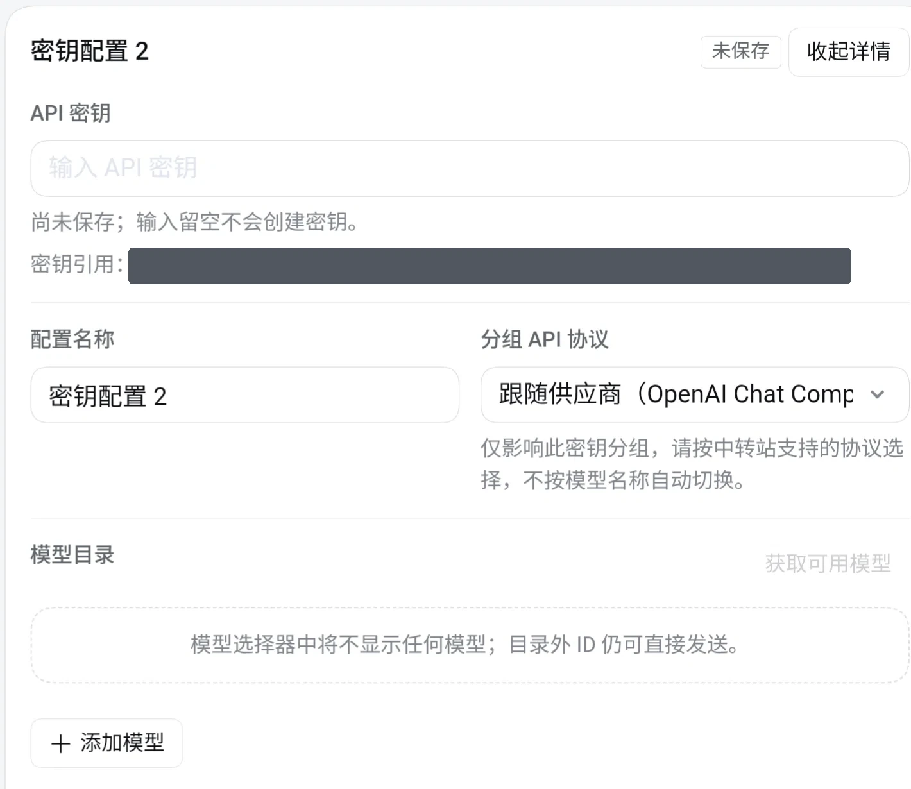
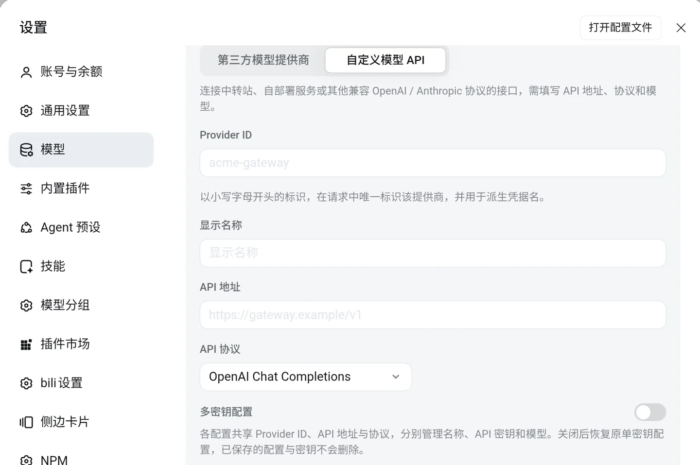
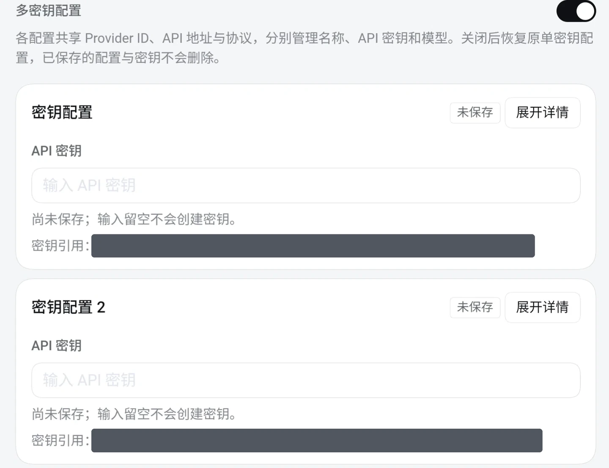
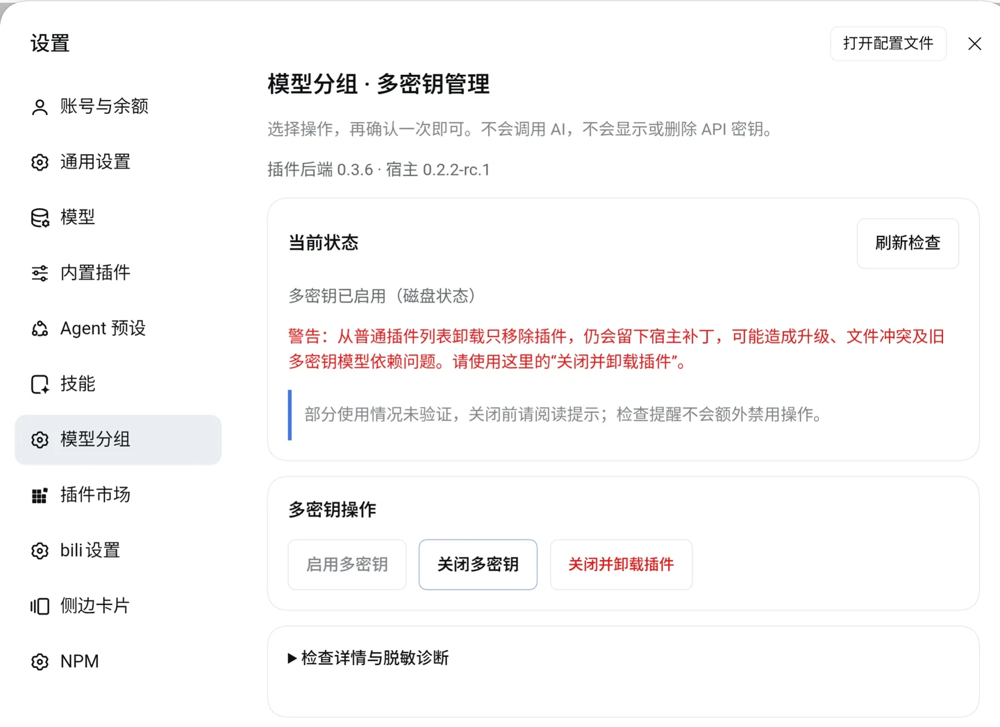

# DSH Model Groups · 模型分组

**在 DeepSeek Harness（DSH）网页端，按供应商、密钥配置和模型逐级选择。** 如果同一家供应商有多把 API 密钥，可以为每把密钥分别设置模型列表和 API 协议。即使模型名称一样，也能选中你要用的那份配置。插件不会自动换密钥或切换供应商。

需要 **Node.js 22 或更新版本**。多密钥维护按宿主实际代码判断兼容，不再把 DSH 版本号作为安装或执行门槛；`0.2.2-rc.1` 是历史补丁基准，不是唯一允许的版本。本插件适用于 DSH 网页端，不替换原生 App 的模型菜单。

## 0.3.12-beta.3 · 按实际代码判断兼容

本次测试版移除安装包与维护入口对单一 DSH 版本的限制。安装测试版：

```bash
dsh plugin --profile web add https://github.com/betsunninda9-lgtm/dsh-model-groups/releases/download/v0.3.12-beta.3/dsh-model-groups-0.3.12-beta.3.tgz
```

- DSH 与相关程序包版本只作为诊断信息，稳定版、预发布版或构建标签不同本身不会阻止安装和多密钥维护。
- 只有所需关键结构缺失、位置有歧义或存在实际改动冲突时，才停止多密钥维护。文件身份、可写性、并发写入等事务检查继续保留；只用分组与折叠不依赖多密钥补丁。
- 网页与后端的插件版本不必完全相同；维护协议一致时可互用，协议不兼容时刷新网页后重试。
- 能生成并准确还原补丁不代表任意版本的全部运行语义都相同，仍需验证模型发现、凭据隔离和实际请求。不会自动降级 DSH，也不要求逐个登记手机版版本。

## 0.3.11 · 按需多密钥、可选自动维护与兼容性改进

0.3.11 是当前 npm 正式版；0.3.12 的跨版本兼容改进请安装上方测试包。安装或升级正式版：

```bash
dsh plugin --profile web add dsh-model-groups@0.3.11 --registry=https://registry.npmjs.org/
```

- 首次安装仅提供模型列表分组与折叠，不自动安装多密钥补丁。首次在设置页手动启用多密钥后，默认打开 **自动维护多密钥补丁**。0.3.12 本地测试版允许在对话运行时准备磁盘补丁；发现同安装目录的其他引擎时仍暂缓，不自动重启。
- 自动维护开关可随时关闭：保留当前功能，宿主更新后需要手动恢复。此过程仅在本地处理程序文件，不调用模型 API、不消耗模型额度。
- 主动关闭多密钥时保留 `restore-pending.json` 标记，之后启动不会自动重新启用；需要时在设置页点击 **启用多密钥** 即可恢复。
- 兼容判断增加片段匹配，保留宿主中与补丁无关的变化。整文件哈希仍用于识别已知版本和验证完整性，但不再作为拒绝未知构建的唯一依据。关键片段缺失、匹配歧义或验证失败时仍会整批停止。
- **启用多密钥**和**更新多密钥补丁**点击后直接检查并执行；关闭和卸载各保留一次确认。磁盘修复后仍可能需要重启原 DSH 引擎并刷新网页，页面会给出提示。

0.3.11 正式版当时只声明支持 DSH `0.2.2-rc.1`；0.3.12-beta.3 已改为按实际代码判断，不因版本号不同而直接拒绝。下面的分组、配置和关闭流程继续沿用。

## 最近正式更新 · 0.3.10

- **分组批量开关**：识图和思考强度分别控制，开启则当前组全开，关闭则全关。
- **保留原版模型界面**：单个模型仍在原详情中单独调整；之后新增的模型沿用最近一次批量设置，重新拉取保留已有模型的单独修改。
- **沿用原保存按钮**：两个能力独立修改，思考开启提供档位选择，不强制使用高强度。

0.3.10 正式包的更新步骤：安装后重启 DSH、刷新网页，在 **设置 → 模型分组** 更新多密钥补丁，再重启并刷新。已使用 beta.2 且补丁就绪的用户无需重复应用相同补丁。[能力开关使用说明](docs/capabilities-beta.md)。

## 上次正式更新 · 0.3.9

- **手机也能排序**：在设置页长按三横线手柄约 400 毫秒，即可调整密钥分组及组内模型顺序；蓝色插入线会提示落点，靠近边缘可自动滚动。
- **保存后顺序保留**：使用原表单保存按钮，退出再进入设置、打开聊天模型菜单都沿用已保存顺序。未保存的输入和展开状态会保留。
- **修复测试版排序回退**，并分别显示插件前端、后端版本，方便核对更新。

0.3.9 正式包的更新步骤：在 **设置 → 模型分组** 更新多密钥补丁，再重启 DSH 引擎并刷新网页。

查看 [每次更新的内容](CHANGELOG.md) · [GitHub 发布记录与安装包](https://github.com/betsunninda9-lgtm/dsh-model-groups/releases)。

## 安装

在运行 DSH 的环境里执行（如果你使用的 DSH 配置不是 `web`，把命令中的 `web` 换成你的配置名）：

```bash
dsh plugin --profile web add dsh-model-groups@latest --registry=https://registry.npmjs.org/
```

如果 npm 尚未同步到你需要的版本，可以把 `dsh-model-groups@latest` 换成 [GitHub 0.3.10 正式版安装包](https://github.com/betsunninda9-lgtm/dsh-model-groups/releases/download/v0.3.10/dsh-model-groups-0.3.10.tgz) 的下载地址。安装后，**重启正在使用的 DSH 引擎，再刷新网页**。只想给现有模型分组？装好就可以用，不需要启用多密钥。

## 在对话中选模型

打开输入框旁的模型菜单，展开供应商，选择模型。启用了多密钥的供应商会多一级 **密钥配置**。你可以搜索模型或配置名称、展开或收起全部分组，也可以在菜单底部切换 **侧边面板** 或 **原地折叠**。清空搜索后会恢复原来的展开状态。

开启多密钥前就已选中普通模型的会话会保留原选择，菜单中标为 **原单密钥（兼容旧会话）**。

## 为同一家供应商添加多把密钥

### 启用多密钥

首次安装时多密钥保持关闭，只用折叠无需额外操作。需要多密钥时，在 **设置 → 模型分组** 点击 **启用多密钥**，无需第二次弹窗确认。首次成功启用后默认打开 **自动维护多密钥补丁**；关闭自动维护保留现有功能，宿主更新覆盖补丁后可手动恢复。若页面提示 DSH 文件已更新，**重启原 DSH 引擎，再刷新网页**。主动关闭多密钥后保持关闭。

执行时会检查并备份 DSH 程序文件，安装目录必须可写。补丁片段完整且唯一的构建可以保留宿主无关变化并应用；关键结构缺失、位置歧义或改动冲突时停止多密钥维护，DSH 或子包版本号不同本身不会触发拒绝。磁盘文件就绪不代表运行中的引擎已经加载新模块。

### 添加密钥配置

1. 打开 **设置 → 模型**，新增或编辑一个支持多密钥的供应商。在 **公共设置** 中填写共享的 API 地址和默认协议。
2. 打开 **多密钥配置**，为第一项填写配置名称、API 密钥和模型列表；有更多密钥就点击 **添加密钥配置**。
3. 如果某把密钥需要不同的 API 协议，在 **分组 API 协议** 中选择；不确定时保留 **跟随供应商**，并以供应商说明为准。可选协议包括 OpenAI Chat Completions、OpenAI Responses 和 Anthropic Messages。API 地址写中转站给你的那个（结尾带不带 `/v1` 都可以）：Anthropic 这一项会自动去掉结尾的 `/v1`，避免同一段路径出现两次。
4. 点击 **应用**（新建时点击 **创建提供商**）。已保存的配置默认收起；要修改模型列表，点击 **展开详情**。编辑时将已保存的密钥输入框留空，原密钥会保留。



*展开一项密钥配置后，可以设置该项的 API 协议和模型列表。截图中的内部密钥引用已遮盖。*

<details>
<summary>查看开关位置、折叠效果和添加按钮</summary>

**找到开关**：新建供应商时，选择 **自定义模型 API**，在 **API 协议** 下方打开 **多密钥配置**。



**查看多份配置**：点击 **展开详情** 编辑对应配置，不必逐个展开其他配置。



**继续添加**：在配置列表下方点击 **添加密钥配置**。每份密钥配置至少需要一个模型。


</details>

如果只想让某个供应商恢复使用单密钥，先保存或清空尚未保存的密钥输入，再关掉该供应商的 **多密钥配置** 并点击 **应用**。已保存的多密钥配置不会被删除。

## 更新

1. 在原 DSH 配置中用目标版本重新执行安装命令，**不需要先卸载**。重启 DSH 引擎并刷新网页。正式包仍按对应发布记录操作。
2. 只有已启用多密钥且打开自动维护时，插件启动才自动恢复兼容补丁；若修改了磁盘文件，按提示重启原引擎并刷新网页。只用折叠或此前主动关闭多密钥时，不会自动安装补丁。
3. 如果自动恢复暂缓，或页面仍出现 **更新多密钥补丁**，先处理页面提示，再直接点击更新；不再弹出第二次确认。没有更新提示就不用重复操作。

已识别的旧补丁及通过兼容片段验证的构建可直接更新，不用逐版安装。若提示关键结构缺失、位置歧义或改动冲突，请保留配置并复制诊断反馈；不要先卸载、还原补丁或删除配置。App 或 DSH 更新可能替换宿主文件，兼容恢复会重新检查实际代码。只改变版本号不会要求逐版本适配；必要接口发生实际变化时，仍可能需要维护者更新公共兼容逻辑。

## 关闭或卸载

**如果已启用多密钥，不要直接从插件列表或命令行卸载。** 那样只会移除插件，不会还原 DSH 文件。

1. 保存设置草稿、停止运行中的任务，并把仍使用多密钥模型的会话、默认模型及子代理切回普通模型。建议先在各供应商设置里关闭 **多密钥配置** 并应用。
2. 打开 **设置 → 模型分组**，选择 **关闭多密钥**（保留模型分组插件），或 **关闭并卸载插件**（先还原 DSH 文件，再卸载），然后确认。
3. 页面提示需要重启时，**重启 DSH 引擎并刷新网页**。



*「设置 → 模型分组」在多密钥已启用时的界面（0.3.6）。按钮会随当前状态变化。*

关闭或卸载不会删除 API 密钥、供应商配置、聊天历史或备份，也不会替你切换模型。主动关闭会留下 `restore-pending.json` 标记，阻止后续启动自动补回补丁；在设置页直接启用可重新恢复。还原后，旧会话里的多密钥模型可能无法继续使用；原版 DSH 也可能无法读取残留的多密钥设置。遇到这种情况请先反馈诊断，不要直接删除密钥或整个配置。

## 遇到问题

- **找不到多密钥开关**：先在 **设置 → 模型分组** 点击启用，按提示重启原引擎并刷新网页。正式包按其发布记录操作。只有支持多密钥的供应商编辑页会显示此开关，只能填写凭据的简化页面不会显示。
- **不确定是否已经生效**：设置页的 **刷新检查** 只检查文件，不会修改文件或重启引擎。若刚启用、更新或关闭多密钥，请重启引擎再刷新网页。
- **无法启用、更新或卸载**：打开 **设置 → 模型分组 → 检查详情与脱敏诊断**，点击 **复制脱敏诊断**，附在 [GitHub Issue](https://github.com/betsunninda9-lgtm/dsh-model-groups/issues) 中。该诊断不包含 API 密钥、文件路径、配置正文或聊天记录。

开发、测试和命令行恢复说明见 [维护指南](docs/maintenance.md)。项目基于 [MIT 许可证](LICENSE) 开源。部分模型选择器代码改编自 DeepSeek Harness，保留原始版权声明。
